# SQLPlay — Final Build and Verification Report

**Date:** 19 November 2026, Asia/Kolkata (IST). **Builder:** the AI assistant working in Designer. This report separates actual observations from assumptions, retains failed runs, and does not treat a successful build as proof that a deployed application works.

## 1. Project overview

SQLPlay is an interactive SQL learning product. Learners choose from 44 challenges, write SQL in a browser editor, run it against a fictional shop database, and submit an answer for automatic result comparison. The app also includes a free playground and a progress dashboard without sign-in.

The completed library contains 14 Easy, 18 Medium and 12 Hard challenges across 10 topics. It covers SELECT/WHERE, ordering and limits, aggregates, GROUP BY/HAVING, INNER/LEFT/RIGHT/FULL/CROSS/self joins, subqueries, CASE, strings/dates, CTEs including recursion, and window functions. Search, difficulty/topic/completion filters, three progressive hints, an explicit solution reveal, session query history, execution duration and friendly SQL errors are implemented.

The repository is isolated at `/Users/softage/Designer Projects/starter/sqlplay`. Existing starter projects were not replaced. The architecture and implementation stages were planned in chat before application code was written. The repository contains independent `frontend/` and `backend/` projects, tests, screenshot evidence, an ongoing builder log, a README, deployment instructions and this report.

**Public GitHub repository:** https://github.com/DIVYAPRIYADHARSHINI-GIT/sqlplay

**Live frontend:** https://sqlplay-xi.vercel.app

**Live backend:** https://sqlplay-api.vercel.app

**Health endpoint:** https://sqlplay-api.vercel.app/health

Vercel project `sqlplay` has root directory `frontend`, the Vite framework preset and Node 24.x in its project settings. Project `sqlplay-api` has root `backend`, explicit Python routing in vercel.json and Python 3.12 selected in pyproject.toml. These settings were inspected through the authenticated CLI, not inferred from folder names. No account was created and no authentication token was printed or committed.

**Free-service publication follow-up, 19 November 2026:** Git, gh and Vercel were confirmed installed and authenticated before publishing. The Vercel team API explicitly returned plan `hobby` for `divya-6411`. The public GitHub repository did not already exist; it was created using gh and main was pushed with screenshots, retained bugs and the reports. The repository-local identity is Divya Priyadharshini / divyapriyadharshini@softage.ai. The existing initial commit was preserved rather than rewriting history.

The backend was redeployed first and public health returned HTTP 200. The frontend was then deployed with VITE_API_BASE_URL pointing to the live backend. CORS_ORIGINS was set to the exact frontend origin and the backend was redeployed again. All deployments completed on Hobby without a size, time or quota failure. No paid database, add-on, plan upgrade or payment details were used. Public repositories are included in GitHub Free; the GitHub user API did not expose the account billing-plan field, so an account-level Free subscription is not claimed. Hobby is intended for personal, non-commercial projects. Automatic Git-to-Vercel deployment is not configured; Git pushes and CLI deployments remain separate steps.

The updated root ignore rules cover all dotenv variants, builds, dependencies, caches and hosting metadata. Non-secret setup templates are now named environment.example. The publication audit found zero dotenv files in the index and no matching credential patterns across the staged/current text and reachable history. This is not a guarantee of exhaustive secret detection. Historical .env.example files contain only public localhost URLs and were not secrets. Plan, audit and publication evidence is retained under test-results/publish-* and PUBLISH_LOG.md.

### Final architecture and data flow

The frontend uses React, TypeScript and Vite with CodeMirror SQL highlighting, table/column completion and keyboard shortcuts. Fonts are served locally. Light and dark themes, responsive layouts, semantic controls, keyboard focus and accessible status messages are included.

FastAPI creates seven connected SQLite tables in memory from seed.sql at process startup. The seed contains 113 rows in total: 16 customers, 24 orders, 42 order items, 12 products, 5 categories, 10 employees and 4 departments. Missing emails/cities, guest and unassigned orders, empty categories/departments, unsold products, zero stock, discounts, tied prices/salaries and leap-day dates make the exercises meaningful.

Run sends one query to `/run`. Submit sends it to `/challenges/{id}/submit`. Each execution uses an actual read-only SQLite connection to the in-memory database, plus an authorizer, function allowlist and resource limits. The server executes learner and reference queries on the same seed. It ignores column names, preserves column positions and duplicate rows, compares numbers with small absolute/relative tolerances, and enforces row order only where specified. Feedback distinguishes wrong column counts, row counts and values/order without returning the reference answer.

The browser stores checked submissions locally and derives solved totals, level/topic progress, completion percentage, streaks and six badges. JSON export/import validates backups and confirms replacement. Query history is session-only; SQLPlay does not log or persist submitted SQL on its backend. Hosting request metadata is outside that application-level promise. Queries necessarily travel to the server, so the final homepage wording does not make an absolute claim that arbitrary text typed by a learner never leaves the device.

## 2. Testing and screenshot evidence

Counts below are actual test cases or named API checks, not a fabricated count of individual assertions. Repeated runs are not added together as unique coverage. Full output and machine-readable results remain in `test-results/`.

### Final suite results

| Suite | Passed | Failed | Evidence and scope |
| --- | ---: | ---: | --- |
| Backend unit/API/seed/safety/reference tests | 162 | 0 | backend-release.txt; includes 44 reference passes, 44 wrong-answer failures, safety, comparator, seed, endpoints, deployment manifest and host-portability regressions |
| Frontend unit tests | 38 | 0 | frontend-release.txt / frontend-final.txt; 33 progress/filter tests and 5 API success/error tests |
| Final-source local browser suite | 33 | 0 | browser-local-verified.json; full journeys, editor, import/export, themes and layout |
| Local browser after final visual review | 33 | 0 | browser-local-final-review.json; also asserts ER arrowheads are outside table boxes |
| Live API suite | 104 | 0 | live-api-final.json; every reference and deliberately wrong answer, safety, health, strict validation and CORS |
| Live browser suite | 33 | 0 | browser-live.json; public production frontend and actual production API |
| Final post-polish live browser rerun | 33 | 0 | browser-live-final.json; final deployed UI, including the ER endpoint regression |
| TypeScript and production build | Passed | 0 errors | build-release.txt / build-final.txt; not represented as a numbered assertion suite |
| npm dependency audit | 0 vulnerabilities | 0 findings | npm-audit-final.json; not an independent security audit |

### Free-service publication verification

After the GitHub push and the ordered Hobby redeployment, the suites were run again rather than reusing the earlier results:

| Publication suite | Passed | Failed | Retained evidence |
| --- | ---: | ---: | --- |
| Backend unit/API tests | 162 | 0 | publish-backend-tests.txt; same one third-party deprecation warning |
| Frontend unit tests | 38 | 0 | publish-frontend-tests.txt |
| Live API checks | 104 | 0 | publish-live-api.json; every reference/wrong answer, safety and allowed/denied CORS origins |
| Live Chrome browser tests | 33 | 0 | publish-live-browser.json; the actual public frontend and backend |

The public health check before frontend deployment returned HTTP 200 in 0.634077 s. The later verifier measured 652.43, 582.69 and 555.85 ms across three health requests. These are observed network durations, not forced cold-start measurements. The browser journey opened a challenge, ran a query, submitted wrong and correct answers, displayed feedback and updated local progress. No unexpected console/page/CORS error or new failed test occurred in this publication run. Intentional negative tests still exercise error responses. No prior failure evidence was removed.

Fresh live images use the publish-live prefix so the original build captures remain intact. The following are from this publication verification, not copied from the earlier run:

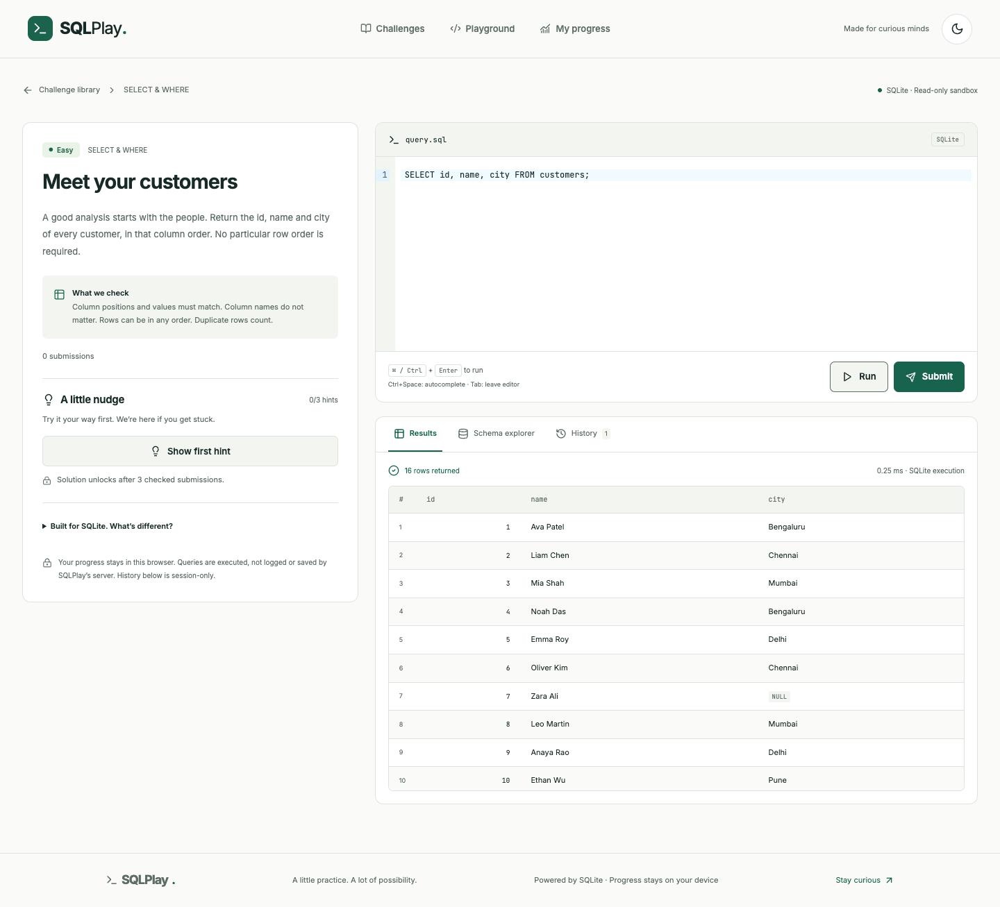

*The newly deployed public frontend returned real SQLite rows after Run.*

*A correct answer passed against the live API and marked the challenge solved.*

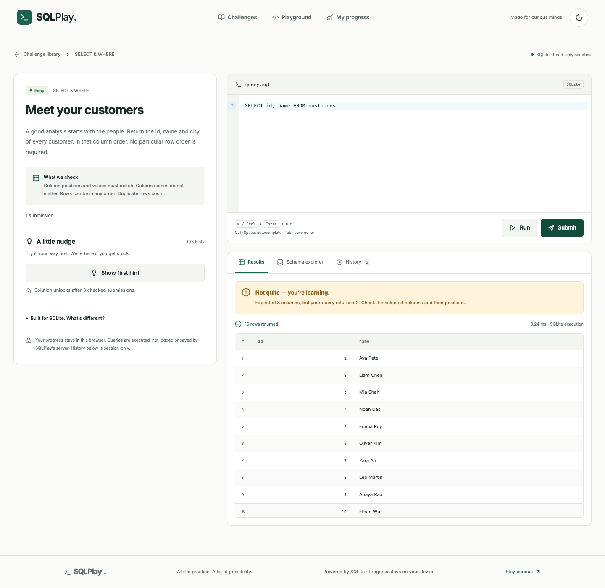

*A deliberately wrong answer received specific feedback without leaking the solution. It is an expected test outcome, not a new application defect.*

The 33 browser tests contain 20 axe/layout audits: five main pages at 390 and 1440 pixels, each in light and dark themes. These reported zero serious/critical violations in the successful runs. Two additional tests visit all five pages at 768 and 1024 pixels in both themes and check page overflow. Table and column autocomplete, run/submit shortcuts, Tab exit, skip navigation, persistence, backup validation, wrong/correct feedback, hints, solution reveal, schema samples and history restoration are exercised. The final successful live run recorded no unexpected page, console or CORS errors. Deliberate negative HTTP tests permit their expected 400/404/422 resource messages; this is not a claim that no error response was ever generated.

Only the specifically named loading and API-error-state browser tests intercept requests. The actual Run/Submit journey and all 104 live API checks use the deployed backend. The checker tests include unordered duplicates, NULL versus text, numeric tolerance, overlapping tolerant matches, column position and ordered results. Safety tests attempt multiple statements, writes, PRAGMA, attachment, extension/file functions, system tables, long queries, excess rows, recursive queries and expensive cross joins.

### Earlier failures and retries — retained, not hidden

| Run | Passed | Failed | What happened |
| --- | ---: | ---: | --- |
| Initial dependency installation | Not run | Install failed | Python 3.15/Pydantic native-build mismatch; no test counts claimed |
| First backend test run | 154 | 5 | COUNT/read-authorizer metadata bug |
| Backend after authorizer fix | 159 | 0 | Original full suite green |
| Backend after manifest regression | 160 | 0 | Added dependency parity test |
| First frontend unit run | 33 | 0 | Initial model tests passed |
| First browser run, stopped/incomplete | 21 | 5 | Four tests did not complete; mock navigation stalled, plus label/focus/contrast defects |
| First complete browser retry | 27 | 3 | Skip-link focus and dark comment contrast remained |
| Corrected original browser suite | 30 | 0 | All original journeys and axe checks passed |
| Initial extended keyboard/tablet suite | 2 | 1 | Tab indented instead of leaving CodeMirror |
| Extended full local suite | 33 | 0 | Keyboard trap corrected |
| First live API run, incomplete | 5 | 88 | GETs passed; every submission failed due to the host's missing optional SQLite method; verifier then crashed on plain text |
| Live API after portability fix | 104 | 0 | All planned checks completed |

Backend tests still emit one third-party Starlette/AnyIO deprecation warning. It is retained in the outputs and is not counted as a failing assertion. The frontend bundle entry is approximately 734 kB uncompressed / 239 kB gzip; it includes editor code and is a known performance improvement area rather than a hidden build failure.

### Hosting and cold-start observations

The corrected initial backend health request returned HTTP 200 in 0.661478 seconds and reported SQLite 3.40.0. After the execution-portability fix, the live verifier's three health requests took 621.74, 569.57 and 452.97 ms respectively. These are measured HTTP durations, including network overhead. They are not SQLite execution times and are not a proven cold-start benchmark.

Fresh deployments and repeated public requests were tested. I could not force Vercel to evict an instance or establish whether its infrastructure had already warmed a function. Forced cold-start behaviour, long-idle recovery and a cold-start latency distribution therefore remain unverified. The final health endpoint now exercises the actual restricted connection rather than returning metadata alone.

### Testing screenshots

All images below are real Chrome captures made during testing. `live-` means the public production frontend was loaded; `local-` means the local production build. The homepage editor illustration is explicitly labelled an illustrative preview in the app; the challenge results are real API executions.

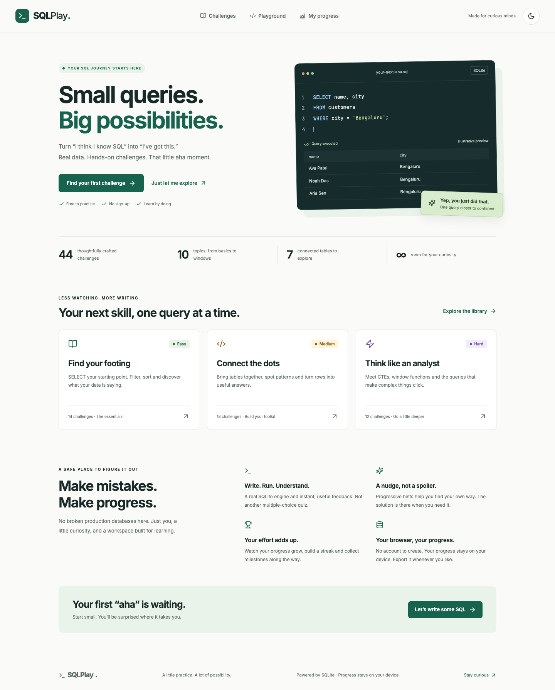

*Live home page at the production URL, with the learning introduction and challenge entry points.*

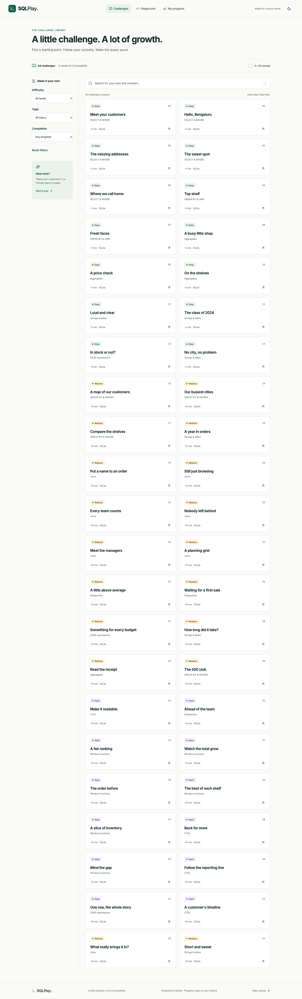

*Live library containing all 44 challenges. The original full-resolution image is available in screenshots/; the PDF scales this long page to fit.*

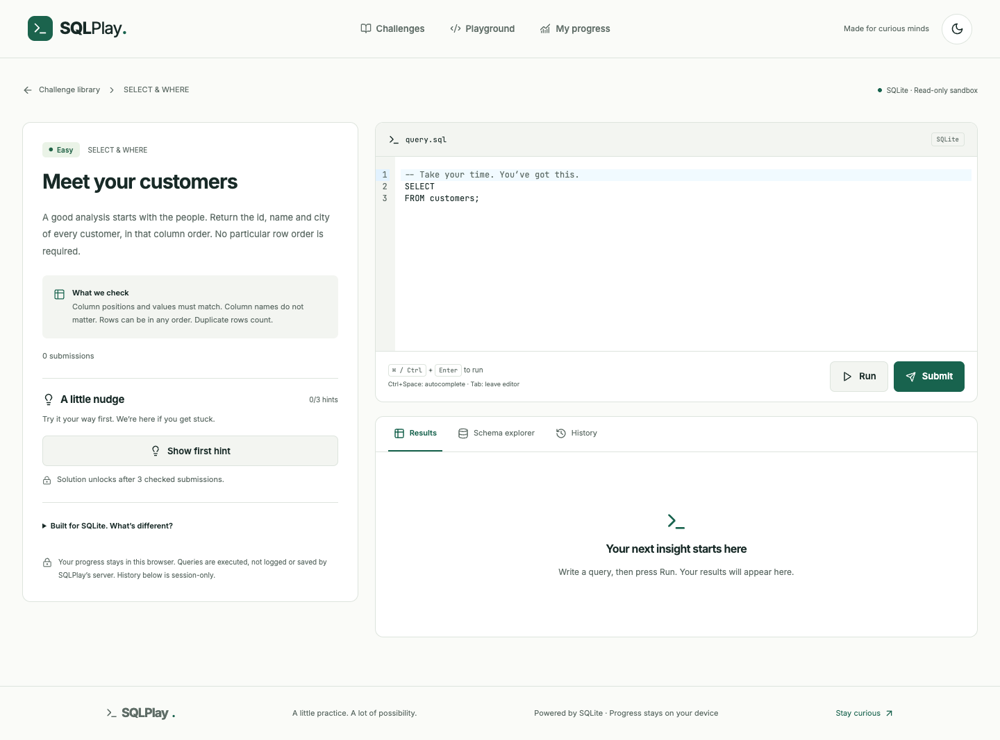

*Live challenge page before execution, showing the prompt, SQLite editor, Run/Submit controls and result placeholder.*

*Run returned the 16 sample customers and displayed the measured SQLite execution time.*

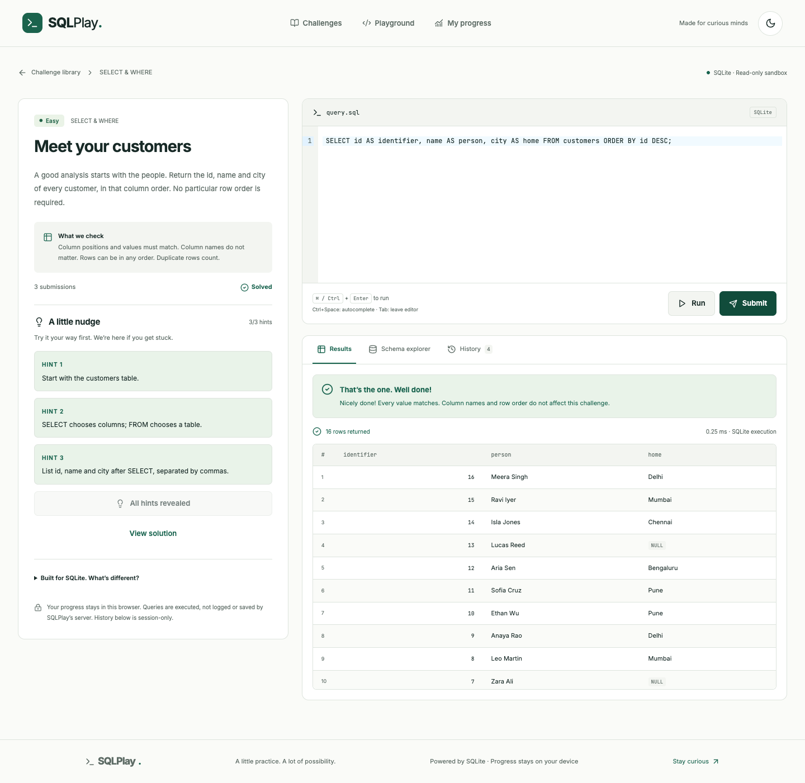

*The correct submission used different aliases and reversed row order. It passed because this challenge ignores names and row order.*

*An intentionally incomplete SELECT returned two columns. Feedback explained that three were required without exposing the solution.*

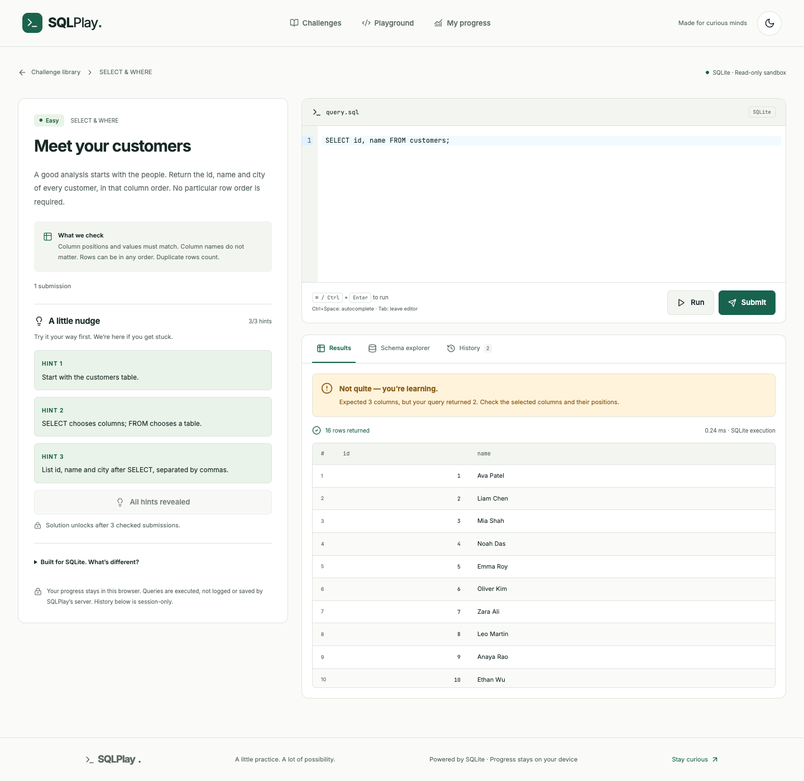

*All three progressive hints were opened through the UI. Solution reveal was separately tested after three checked submissions.*

*The schema explorer shows the ER diagram, table relationships, types and real sample rows. Final visual review moves arrowheads outside the opaque table boxes.*

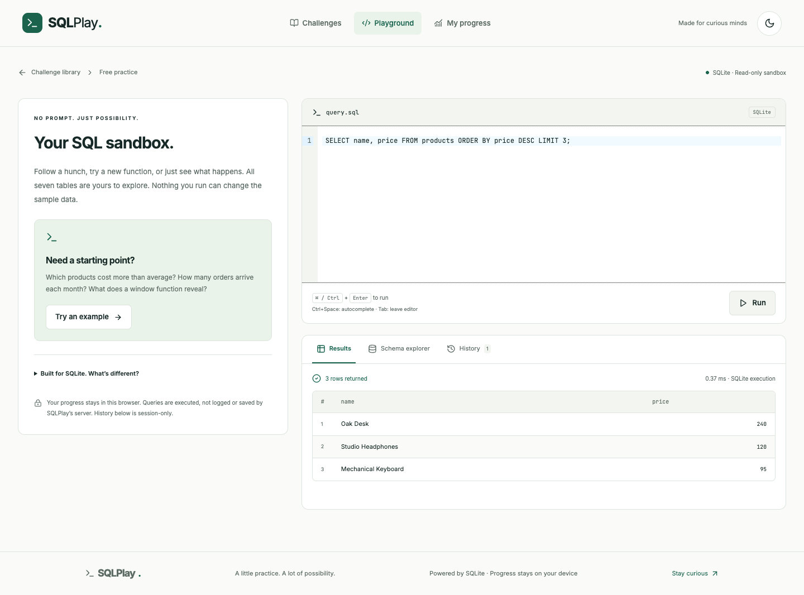

*The playground executes a read-only query independently of a challenge and shows the most expensive products.*

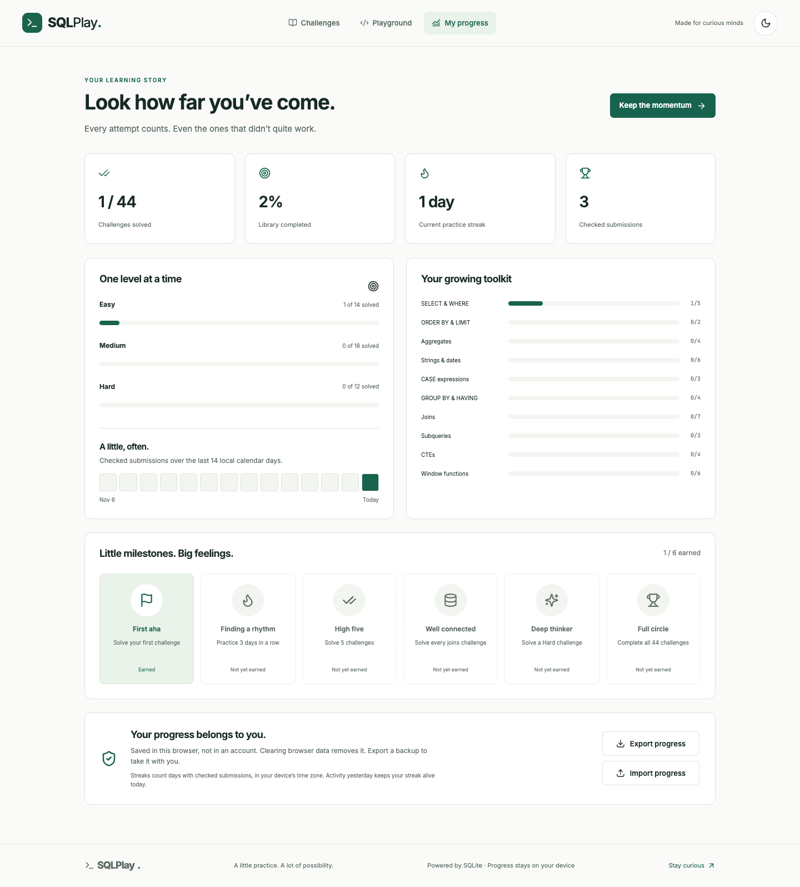

*After two wrong submissions and one correct one, the dashboard shows 1/44 solved, 2% completion, three checked submissions, a one-day streak and the First aha badge. Reload persistence was tested.*

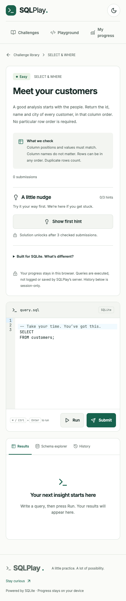

*The 390-pixel browser viewport stacks the prompt and editor without horizontal page overflow. This is emulation, not a physical-phone test.*

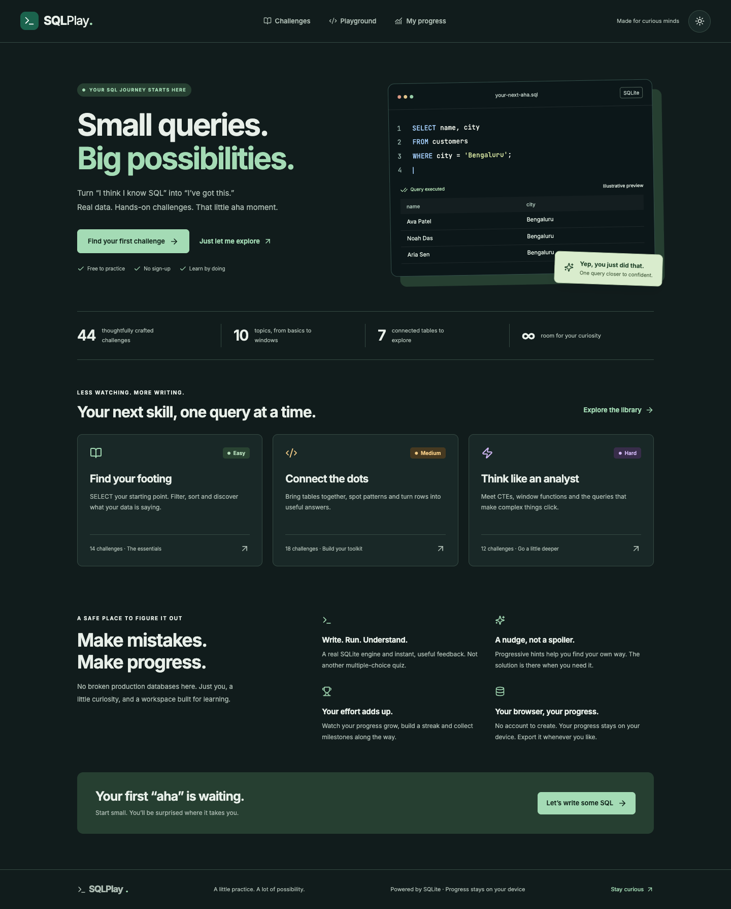

*The dark theme survives a hard reload. Separate audits also check the dark editor and progress pages.*

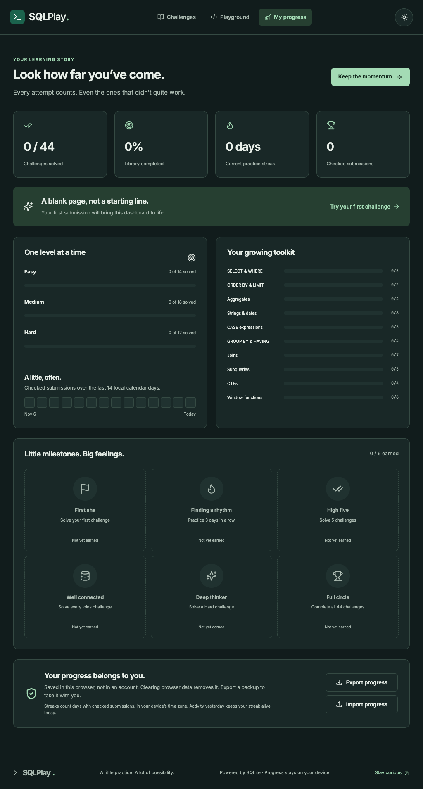

*The 1024-pixel dark dashboard is one of the additional tablet-layout checks. The suite also visits all main pages at 768 pixels.*

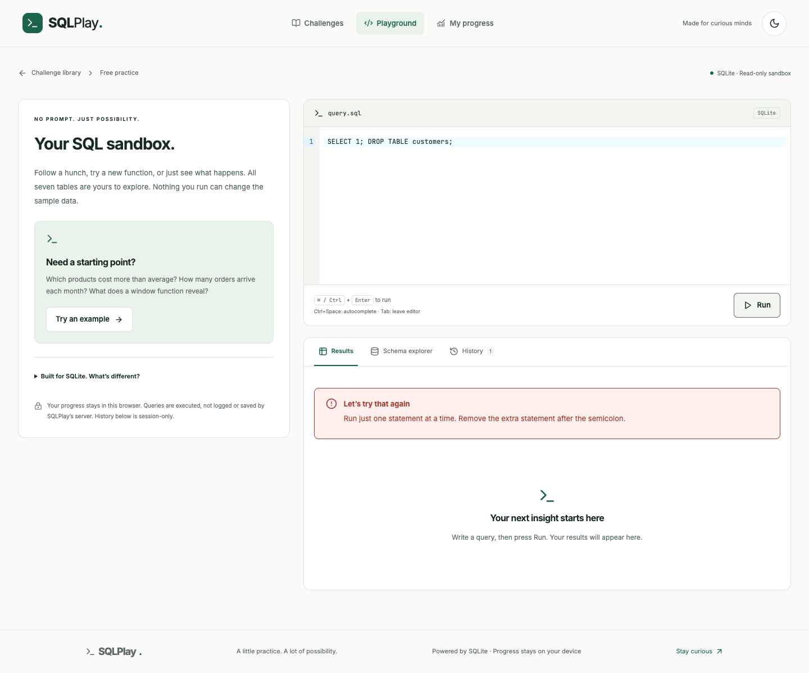

*An intentional multiple-statement request is rejected safely. This is expected negative-test feedback, not a passing SQL answer or a hidden defect.*

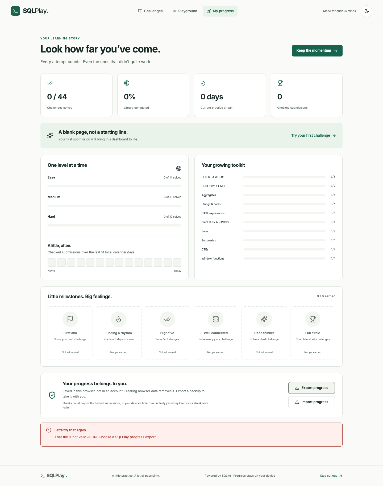

*An invalid JSON backup is rejected before progress is replaced. Valid import, cancellation, replacement and subsequent reload were tested separately.*

The `screenshots/` folder also contains local equivalents, all 20 responsive/theme audit captures, empty-library, loading and simulated API-error states. The live image prefix and browser result JSON establish deployment provenance; screenshots alone do not prove that an API worked.

## 3. Bugs, issues and how they were handled

The following paragraphs cover application defects, test-harness defects, environment problems and tool retries separately. They are not all attributed to Designer. No retained failure screenshot was deleted or renamed after a fix. A copied original schema screenshot is explicitly identified as such.

### Environment selection and preflight probes

The starter root was not a Git repository, so an isolated SQLPlay repository was created. A probe for a neighbouring tools directory failed; the project installed its own Playwright dependencies instead. More importantly, the first virtual environment ran Python 3.15 despite the initial python3 version probe showing 3.11. Pydantic's native build refused that interpreter. Recreating the venv with the explicit Homebrew Python 3.11 executable fixed installation. No backend tests ran during the failed install.

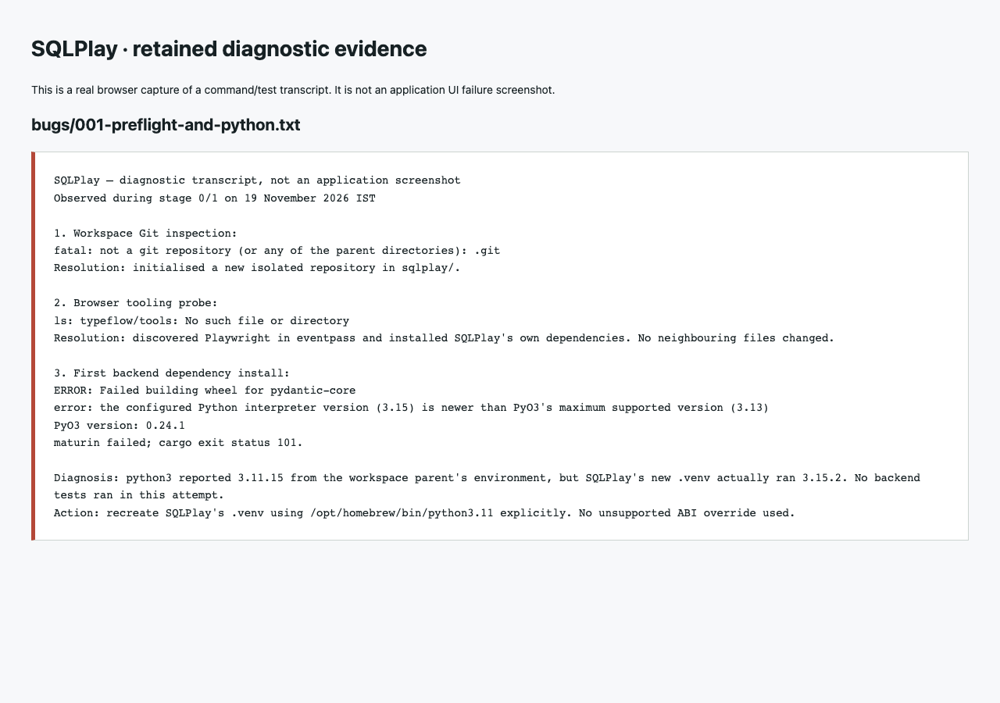

*Real browser capture of the retained diagnostic transcript. It is not presented as an SQLPlay UI screenshot.*

### Vulnerable development dependencies

The first npm install reported one moderate and two critical findings in the old Vitest dependency chain. The test runner was upgraded to Vitest 5.1.1. The final audit reports zero vulnerabilities. These were real dependency findings, not proof that the production application had been exploited.

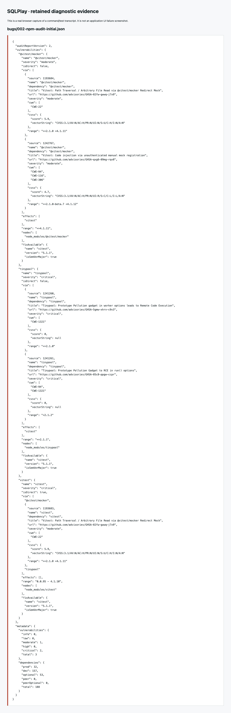

*The original audit JSON was retained and rendered in the browser for evidence.*

### Valid COUNT queries rejected by the sandbox

Five backend tests failed because the SQLite authorizer sometimes reports COUNT(*) and count-only join reads with an empty column name and no database name. The guard required main and rejected those valid reads. Inspecting the actual callback arguments identified the mismatch. The fix permits only that narrow metadata case for the seven allowlisted tables; it does not permit system tables or additional actions. All original 159 tests passed afterward.

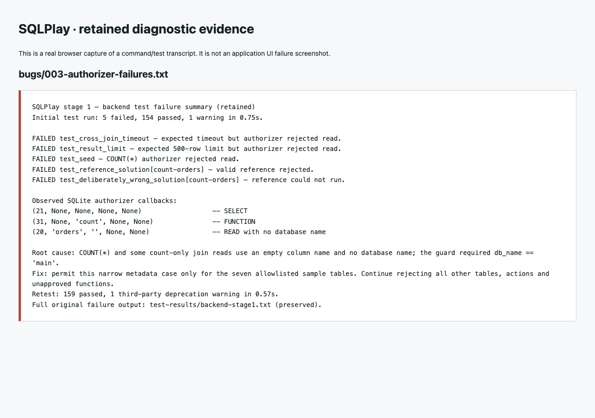

*Retained summary of the five actual failures and the observed SQLite callbacks.*

### Occupied ports and unavailable shell utility

The first Uvicorn launch failed because port 8000 was occupied; 5173 was also already used. Those unrelated apps were not stopped. SQLPlay was tested on 8017 and 5177 with explicit API/CORS configuration. Later, a diagnostic process-list command attempted to use rg, which was unavailable in the shell. Designer's file-search tools remained usable. These were environment/probe issues, not user-facing product failures.

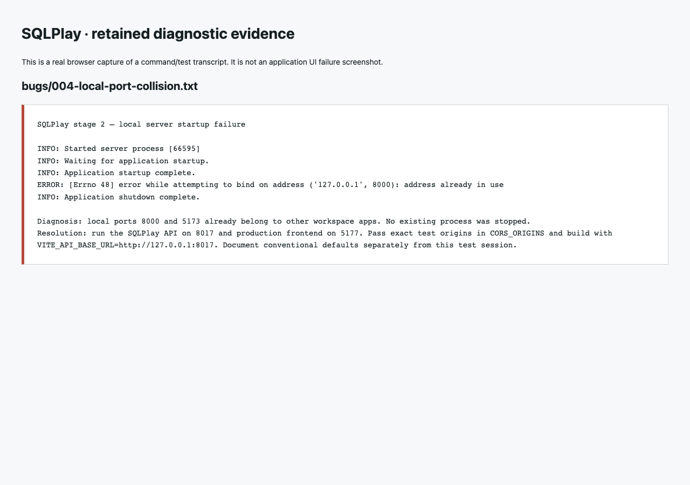

*The actual startup failure and non-destructive port change are recorded here.*

### Topic label and overly broad browser mocks

The filter test timed out after selecting Hard because its exact Topic-label lookup was ambiguous. An explicit accessible name fixed it. Separately, the API-error test mocked every URL ending in /challenges, including the frontend document request. The browser displayed mock JSON instead of the app. The loading test shared that mistake and stalled navigation. Both mocks were restricted to non-document requests.

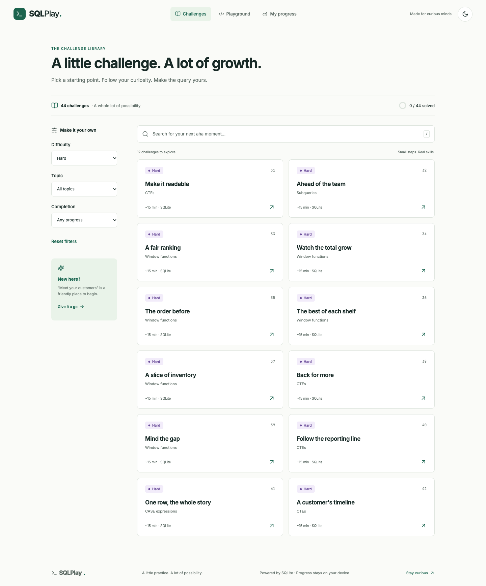

*The real page at the failed exact-label lookup; Hard filtering itself had succeeded.*

*The actual browser displayed JSON because the test harness intercepted the HTML navigation. This was a test defect, not the intended application error state.*

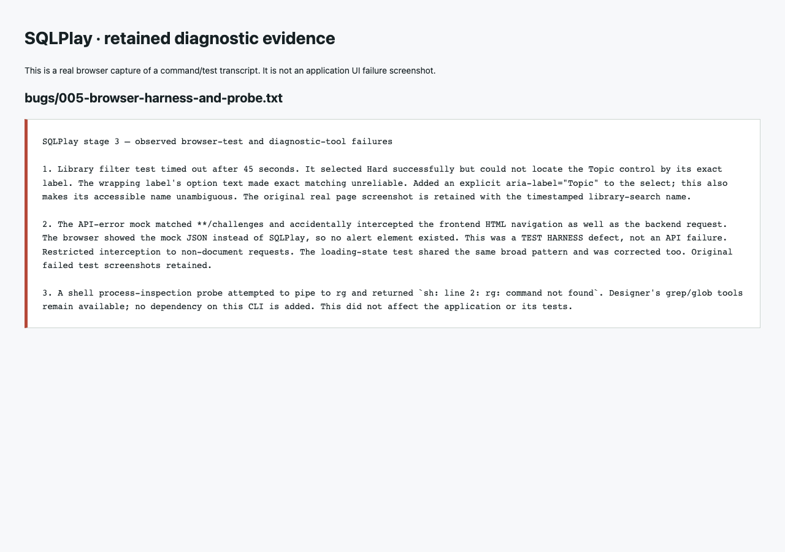

*The mock corrections and missing-rg probe are documented. The stalled loading navigation did not yield an original direct screenshot: capture also timed out. Its transcript is retained; no image is invented for it.*

### Initial focus bypassed the skip link

The route effect focused main on first load as well as on client-side navigation. A real keyboard test showed that the first Tab after reload bypassed the skip link. The app now leaves native initial focus alone and moves focus to main only on in-app route changes. The keyboard test passes locally and live.

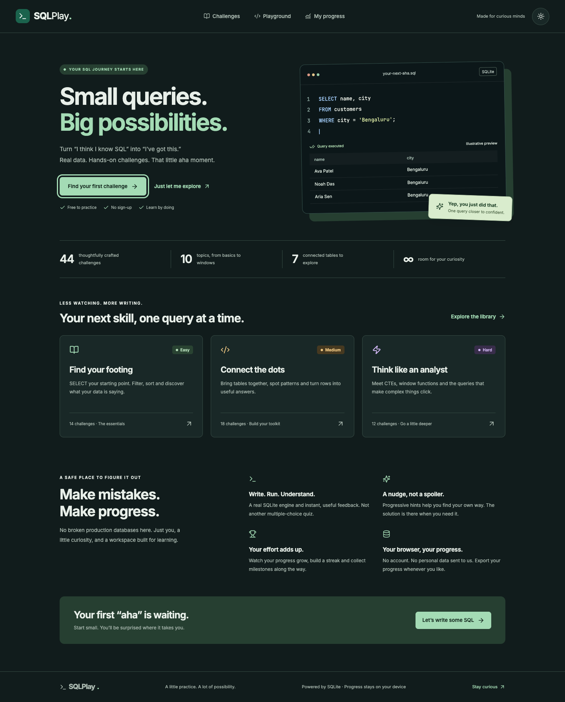

*Retained page capture from the failed focus assertion; the text failure record contains the exact focus mismatch.*

### Dark SQL comments failed contrast

Axe measured CodeMirror's default dark comment colour at 3.95:1 over the active line, below the required 4.5:1 for its 12-pixel text. The same defect failed both mobile and desktop checks. A stable comment highlighting class now uses the app's muted token, and both checks pass. Other original and retry captures remain in bugs/.

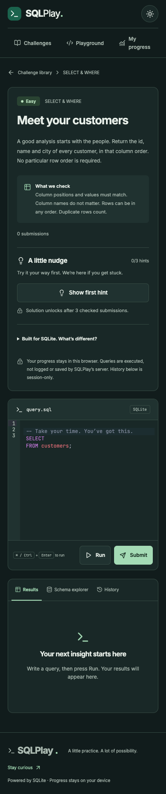

*The real mobile dark challenge page before the contrast correction. Matching axe JSON records the exact colours and ratio.*

### Tab stayed inside CodeMirror

An additional keyboard test found that the React CodeMirror wrapper defaults to Tab indentation. This contradicted the on-screen help and prevented the expected move to Run. Setting indentWithTab to false corrected it. Column autocomplete had already succeeded in the failing test; the failure was specifically keyboard exit.

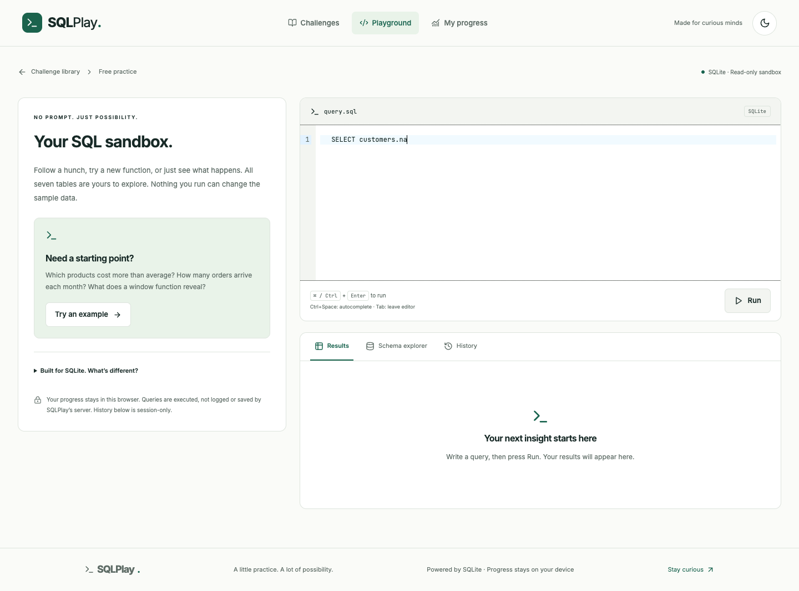

*The failed keyboard-exit test was captured before the wrapper setting changed.*

### Deployment reported Ready but FastAPI was missing

The first backend deployment built successfully but public health returned 500 FUNCTION_INVOCATION_FAILED. Vercel installed from pyproject.toml preferentially; that initial file specified Python but omitted dependencies. Runtime logs showed ModuleNotFoundError for fastapi. Matching dependencies were added to pyproject.toml and requirements.txt, with a regression test. The corrected deployment returned public HTTP 200.

*This is a real screenshot of the failed production health page, captured before the packaging fix.*

### CLI scope, log filtering and process lifecycle

A runtime-log call returned not_linked even with an explicit project name. Adding the Vercel team scope fixed it. An error-only log filter then returned no records because the import traceback was classified as info on stderr; an unfiltered runtime query exposed the cause. No secret or request-body log was read.

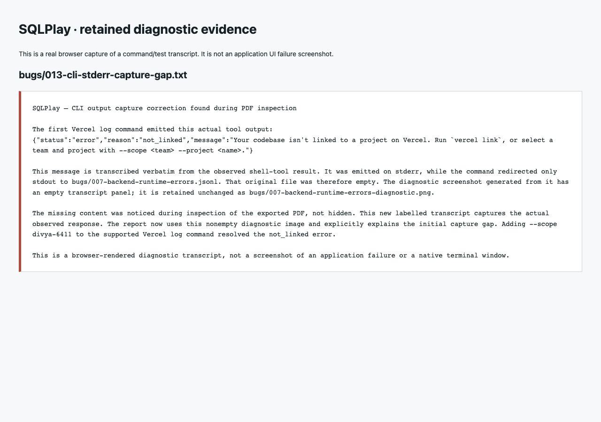

*Browser-rendered copy of the actual not_linked tool response. PDF inspection exposed that the first redirected stdout file was empty because the error arrived on stderr. The original empty file and blank-panel diagnostic screenshot remain unchanged in bugs/007-backend-runtime-errors-diagnostic.png; this corrected transcript explicitly explains the evidence gap.*

The VITE_API_BASE_URL environment command printed Added but did not exit. Sending EOF did not resolve that process. It was stopped after 2m23s; the saved setting was verified and deployment was run in a fresh process with stdin closed. A tail probe before the deploy log existed also returned No such file or directory. The internal reason for the CLI hang is not proven and is not blamed on Designer without evidence.

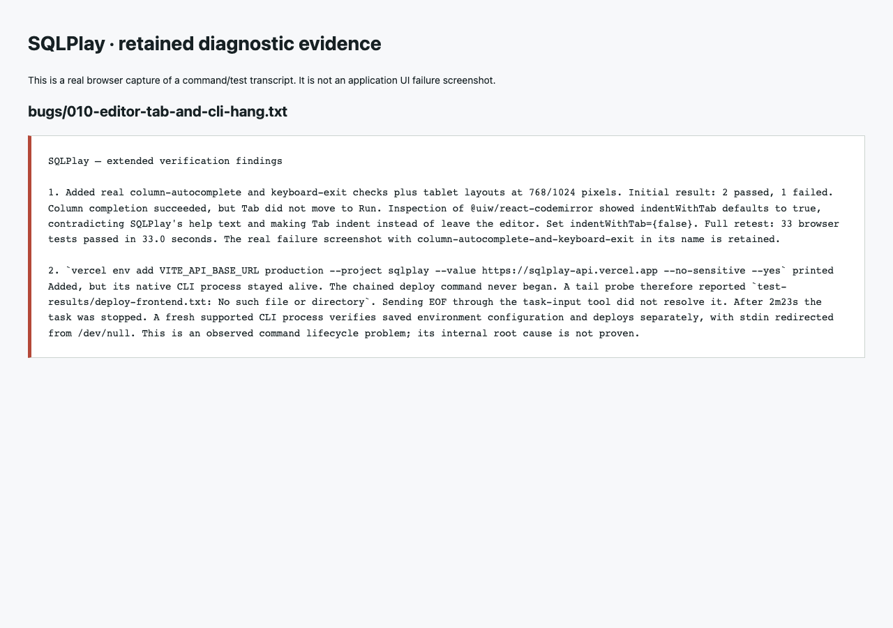

*Retained transcript of the real command hang and the keyboard finding. The separate original blank-panel CLI capture is retained unchanged, with its stderr capture gap explained above.*

### Host SQLite omitted an optional method; verifier also assumed JSON

The first live API test passed five GET checks but failed all 88 challenge submission checks. The host's sqlite3 build compiles extension loading out and therefore does not expose enable_load_extension. Calling it unconditionally raised AttributeError. The local SQLite build exposed it, so local tests had not revealed the portability difference.

The fix checks for that optional method while retaining the authorizer's load_extension denial. A simulated no-extension-build test verifies the path. Health now runs a real restricted SELECT and returns an unavailable status if that path fails. This directly addresses why the original health response was an insufficient readiness check.

The live verifier then crashed while formatting the next plain-text 500 because it called .get on a string. It now handles non-JSON bodies and persists partial result JSON after each check. The frontend also has a friendly non-JSON response message and five dedicated API wrapper tests. The final live API run completed all 104 checks successfully.

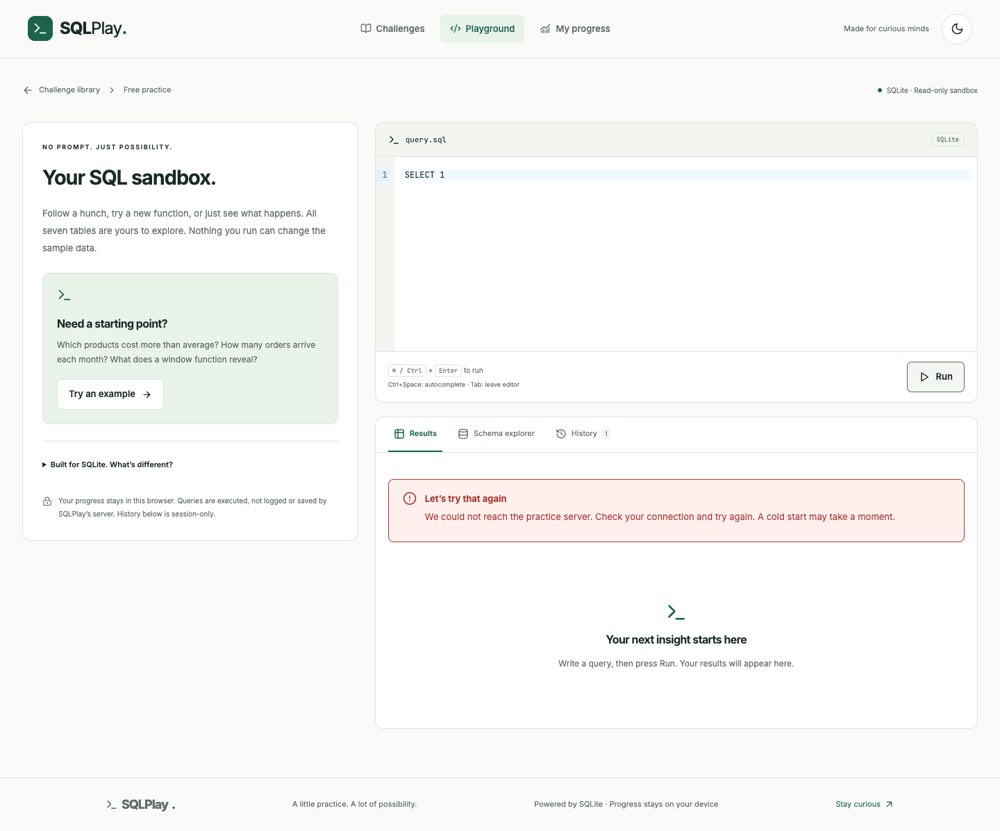

*The public playground displayed connection-retry feedback when its execution request failed. This was captured before the host-compatibility fix.*

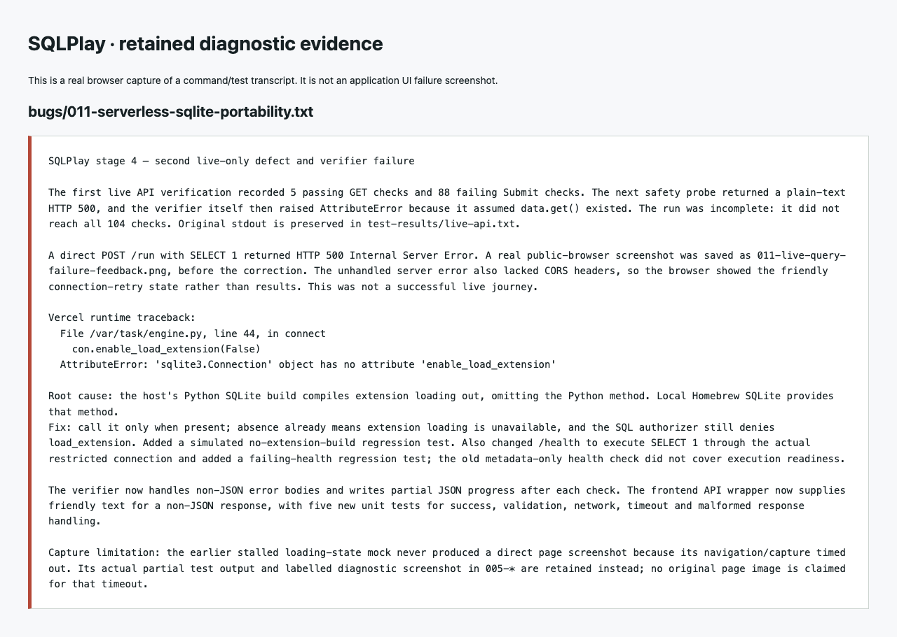

*The real runtime failure, incomplete 5-pass/88-fail run, verifier exception and corrections are documented. Full original live test output remains in test-results/live-api.txt.*

### ER arrowheads were obscured

Final visual inspection showed that connections were drawn centre-to-centre behind the table boxes. The lines were visible, but their arrowheads were hidden. Paths now begin at source boundaries and end just outside target boxes. A browser assertion checks that endpoints do not sit inside opaque rectangles. The original screenshot was copied into bugs/ before correction.

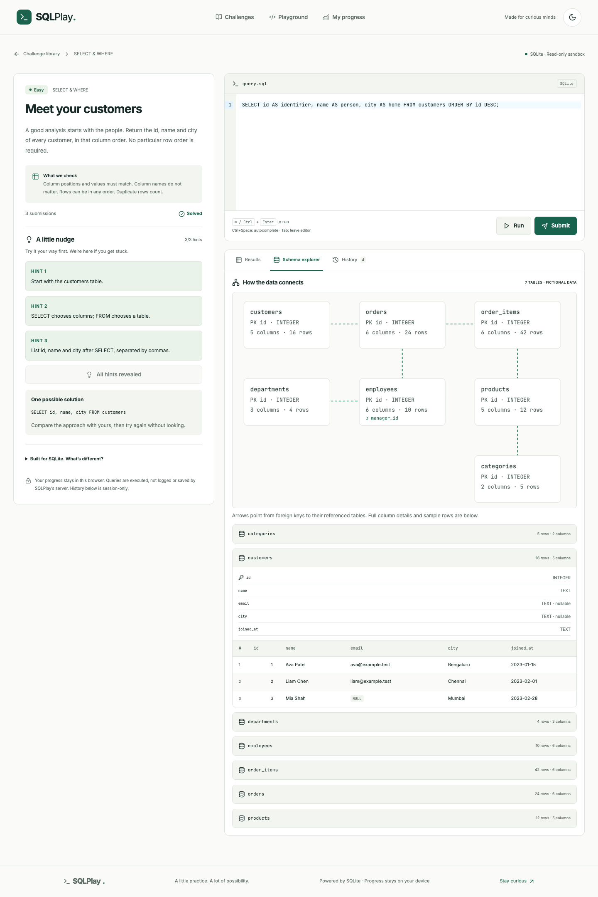

*An exact retained copy of the original live schema screenshot that exposed the visual defect.*

The same wording review narrowed an overbroad homepage privacy claim to say that progress stays on the device. That change is not evidence of an observed data leak. Known remaining warnings include the Starlette/AnyIO deprecation, npm install-script/cache-dir notices and Vercel's explicit-build/protection/Node-version notices. Successful builds and public browser checks were used to establish their actual impact; the warnings were not silently deleted.

## 4. Advantages of Designer observed in this project

Designer let the builder inspect the existing workspace, write a separate project without replacing neighbouring work, make versioned source edits, run local commands and inspect the resulting screenshots in one conversation. The file tools were effective for keeping application code, structured challenge data, tests and documentation together.

Background tasks made it possible to run dependency installation, test suites and deployments without treating a long command as instantly complete. Task output and stop controls were useful when the stalled browser mock and the Vercel environment process required intervention. The retained output made later counts auditable.

Image inspection was particularly useful. It confirmed the desktop/mobile/dark layouts after real browser execution and exposed the ER arrowhead problem that the initial functional tests had missed. This is a concrete benefit, not a claim that visual inspection guarantees accessibility.

External documentation search helped locate the official Vercel deployment guidance. The workflow still required real health, POST and browser checks; the two live-only failures showed why documentation and build success were not enough.

## 5. Disadvantages and limits of Designer observed here

No native browser command was exposed by the command search in this session. Browser automation and screenshot/PDF generation therefore used locally installed Playwright and Chrome through shell commands. That worked, but required custom harness code and dependency setup rather than a single integrated Designer testing workflow.

The environment and external tools introduced friction: inconsistent Python selection, occupied ports, an unavailable rg executable, a Vercel log-scope requirement and a native CLI process that did not exit after reporting success. These are observed limitations of this build workflow. Their existence does not establish that Designer itself caused them.

Failure evidence needed deliberate engineering. The runner was configured to save failure screenshots outside its disposable output directory, and command failures were rendered as labelled browser transcripts. One stalled navigation prevented its original direct page capture. An integrated evidence collector would reduce this manual work and make such gaps more obvious.

Local success did not predict Vercel's packaging precedence or SQLite compile options. The initial readiness check was also too shallow. These were application/deployment mistakes found through live testing, not hidden behind the tool's successful command result.

No Designer application crash, workspace relaunch or unrecoverable long-session failure was observed. I do not claim those occurred. Likewise, no physical-device, screen-reader or forced-cold-start capability was exercised merely because screenshot viewing was available.

## 6. Scope of improvement for future Designer versions

A first-class web verification surface could combine browser actions, console/network capture, accessibility audits and timestamped screenshots. It should save evidence immediately on failure, keep it outside disposable test output, and distinguish actual application screenshots from diagnostic transcripts.

A deployment preflight could compare local and target runtime capabilities, dependency manifests, project roots and environment-variable names. For this project, checking pyproject precedence and the presence or absence of optional SQLite APIs would have caught both live-only defects earlier. A default post-deploy probe should execute a representative operation, not only GET a static health response.

Command lifecycle handling could show when a CLI has printed success but remains alive with no progress, and offer a safe state-verification/retry path. Log tooling should make severity-filter limitations visible; here, a Python import failure appeared as info rather than error.

An integrated evidence index and report/PDF exporter would reduce custom scripting. It should report unfinished checks and missing screenshots explicitly, retain failed attempts after retries, and avoid turning a passing rerun into a misleading history with no failures.

Port/runtime inventory, clear browser-capability discovery, and lightweight production-origin/CORS checks would also make multi-project web work more predictable. These are recommendations arising from this session, not claims about features that already exist.

## 7. Unverified areas and known SQLPlay limits

Forced infrastructure cold starts, idle eviction/recovery, sustained high concurrency, a distributed rate limit and an independent penetration test were not verified. The application has a global per-process token bucket and four execution slots; separate Vercel instances have separate buckets. Hosting infrastructure may retain request metadata even though SQLPlay does not store queries or learner identities.

Testing used installed desktop Chrome with mobile/tablet viewport emulation. Safari, Firefox, real Android/iOS devices, assistive-technology reading order and a full manual WCAG audit remain unverified. Axe results cover the tested page states and serious/critical rules, not every possible interactive state or all accessibility criteria.

The checker verifies result equivalence on one fixed dataset. It does not prove semantic correctness for all data, enforce use of a requested join/CTE/window construct, or prevent a hard-coded answer that happens to match the seed. Numeric tolerance is small but still approximate. SQLite differs from MySQL and PostgreSQL; the app and README explain the main differences.

Progress is local and user-editable, with no account, cloud sync or trusted attempt counter. Clearing browser storage loses it unless a backup was exported. Import replaces rather than merges after confirmation. The most recent 50,000 submissions are retained. Solution-reveal gating is a learning affordance, not a security boundary; a client can report its own attempt count.

Queries are limited to one read-only SELECT/WITH, 8,000 characters, 500 returned rows and approximately 200 ms / 20 million VM operations. SQLite value, expression, column and compound-query limits also apply. Some otherwise valid SQLite functions are intentionally unavailable. The browser's API timeout is 20 seconds. These limits make a learning sandbox, not a general database workbench or a production SQL service.

The initial JavaScript bundle can be reduced by splitting editor dependencies away from non-editor pages. The single fixture is small and has no data version/migration system for future challenge changes. The ER view is a compact educational diagram, not a database modelling editor. The public GitHub origin and main push are now established. No uptime SLA, custom domain or automatic deployment integration was established; future application changes require the documented CLI deployments. Hobby remains subject to free quotas and personal/non-commercial-use terms.

The full-resolution PNGs and original logs are the detailed evidence. PDF image scaling can make long pages harder to read; use the original files for inspection. The stalled loading-mock failure has a transcript and labelled diagnostic capture but no original direct screenshot. No missing result or screenshot is represented as verified.

**Handoff:** The application, two live projects, authored challenges, safety/checking engine, local progress features, tests, evidence log and deployment documentation are complete. The known verification limits above remain explicit rather than being presented as completed work.
